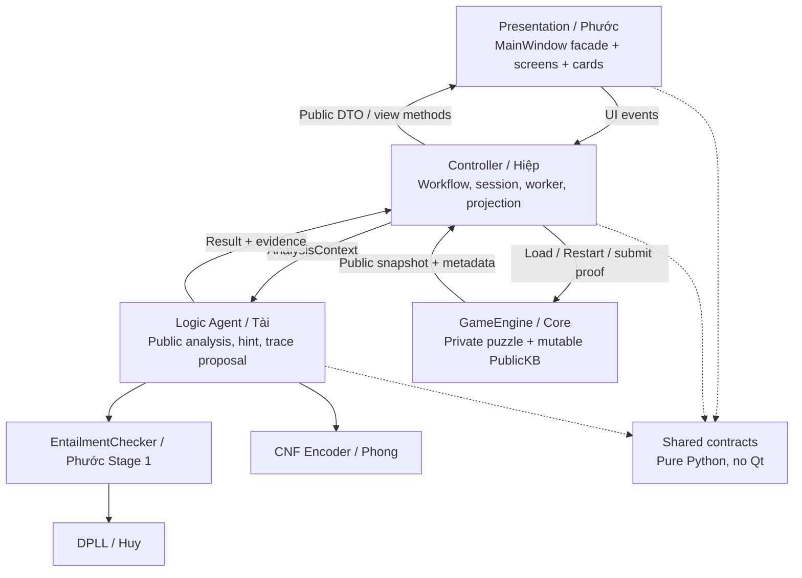
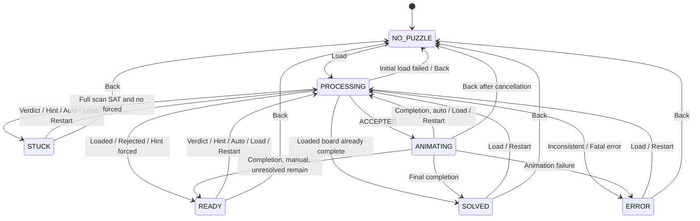

# Griductive Solver — Stage 2 Shared Architecture Baseline V1

**Ngày:** 18/11/2026 · **Hạn dự kiến theo yêu cầu:** 21/11/2026.
**Trạng thái:** bản đề xuất kiến trúc để Tài, Phước, Hiệp review; chưa phải baseline được cả nhóm phê duyệt.
Phạm vi bản này: tài liệu, contracts và phân chia trách nhiệm. Chưa triển khai GUI, Logic Agent, Controller hay animation.

## 1. Mục tiêu và cách đọc

Griductive Solver là game suy luận no-guess của CSC14003. Người chơi chỉ được lật thẻ khi public KB chứng minh
được nhân vật là CRIMINAL hoặc INNOCENT. Stage 2 nối giao diện, điều phối và suy luận với Core Stage 1.
Baseline giúp ba người làm độc lập trên cùng contract, không tạo ba bản trạng thái game hoặc ba định nghĩa verdict.

Đọc [Team README](STAGE2_TEAM_README.md) để bắt đầu;
[API Contract](STAGE2_API_CONTRACT.md) là nguồn chuẩn signatures, DTO và errors;
[UI Design](STAGE2_UI_DESIGN.md) là nguồn chuẩn layout/component;
[Integration Checklist](STAGE2_INTEGRATION_CHECKLIST.md) là tiêu chí review.

`CONFIRMED` = đã thấy trong code hoặc là yêu cầu phạm vi; `PROPOSED` = thiết kế mới chưa được nhóm duyệt;
`BLOCKED` = chưa kiểm chứng tích hợp vì thiếu dependency/quyết định.
Mọi thiết kế Stage 2 trong tài liệu này mặc định **PROPOSED**. Không đổi nhãn thành CONFIRMED chỉ vì đã viết Markdown.

## 2. Repository hiện tại — CONFIRMED tại checkout local

Audit từ commit `011982e`, nhánh đầu vào `feat/phuoc/entailment-engine-15-maps`, working tree sạch.
Nhánh tài liệu: `docs/phuoc/stage2-shared-baseline`. Không fetch remote trong audit này;
các kết luận dưới đây chỉ nói về checkout đã đọc, không khẳng định các nhánh khác chưa có code.

| Thành phần | Hiện trạng | Hệ quả tích hợp |
|---|---|---|
| `src/core/` | Engine, PublicKB, immutable models, loader/validator, VariableMap, CNF aliases, EntailmentResult đã có code | Giữ nguyên, dùng public API |
| `src/agent/entailment.py` | Checker, bool solver protocol/adapter, result bridge đã có | Tài dùng lại để chứng minh verdict |
| `src/solvers/dpll.py` | File rỗng | DPLL runtime BLOCKED, cần Huy bàn giao |
| `src/encoder/cnf_encoder.py` | File rỗng | CNF runtime BLOCKED, cần Phong bàn giao |
| `src/encoder/extended_clues.py`, `semantic_eval.py` | File rỗng | Không giả định extension đã hỗ trợ |
| `src/agent/logic_agent.py`, `deduction_trace.py`, `uniqueness.py` | File rỗng | Chỉ đặc tả API, chưa có Logic Agent |
| `src/gui/app_window.py`, `grid_view.py`, `clue_highlighter.py` | File rỗng | Không có framework GUI hiện hữu gây xung đột |
| `main.py`, `benchmark.py` | File rỗng | Composition root chưa triển khai |
| `src/controller/`, `src/shared/` | Chưa có | Cây thư mục ở phần 5 là đề xuất, chưa tạo |
| `puzzles/` | 15 map trong manifest, 5 mỗi kích thước, thêm `sample_3x3.json` | Menu dùng whitelist 15 entry, không glob để vô tình thêm sample/manifest |
| `puzzles_baseline/` | Backup V1 | Không dùng làm catalog game mặc định |
| `schemas/puzzle.schema.json` | Schema 1.0 | Không đổi schema/dataset cho Stage 2 baseline |
| `tools/` | Generator, reference SAT, validator, báo cáo, HTML preview | Công cụ authoring; không import vào game runtime |
| `requirements.txt` | Ghi Core standard library, Python >=3.10 | Chưa khai báo GUI dependency |
| `requirements-dev.txt` | pytest, jsonschema, python-sat 1.9.dev21 | python-sat là reference authoring, không thay DPLL nhóm |
| `tests/` | Core, entailment, puzzle, reference integration và team integration | Một phần tests skip khi DPLL/Encoder thiếu |

README và `docs/TV1_HANDOFF.md` là tài liệu Stage 1: số TV và ownership cũ khác Stage 2.
Theo yêu cầu mới, **Tài sở hữu Logic Agent**, **Hiệp sở hữu Controller**, **Phước sở hữu GUI**.
Không sửa lịch sử tài liệu cũ trong gói này; bảng ownership dưới đây áp dụng cho phần mới.

## 3. Technology baseline

| Thành phần | Lựa chọn V1 | Trạng thái / kiểm tra |
|---|---|---|
| Language | Python; giữ cú pháp Core >=3.10 | CONFIRMED Core; .venv local là 3.14.4 |
| Python dev chung | Đề xuất Python 3.12 để nhóm dùng cùng môi trường | PROPOSED; không thay .venv hiện tại hoặc khẳng định 3.14 không tương thích |
| GUI | PySide6, Qt Widgets | PROPOSED; không thấy Pygame/PyQt/React implementation trong checkout |
| Board/Card | QGraphicsView + QGraphicsScene; CharacterCard dự kiến QGraphicsObject | PROPOSED |
| Animation | Qt Animation Framework, property của card | PROPOSED; không viết animation ở baseline |
| Communication | Qt Signals/Slots ở presentation/controller bridge; pure Python Protocol ở Agent | PROPOSED |
| Style | QSS cho QWidget; design tokens dùng chung với scene painting | PROPOSED; QSS không tự style mọi QGraphicsItem |
| Puzzle | JSON schema 1.0 hiện có | CONFIRMED |
| Tests | pytest; thêm pytest-qt cho GUI | pytest đã có; pytest-qt PROPOSED |

PySide6 và pytest-qt **chưa được cài** trong .venv audit; chưa chạy Qt smoke test hoặc xác minh plugin đồ họa trên máy nhóm.
Không pin phiên bản PySide6 giả định. Phước đề xuất phiên bản cụ thể, ba người thử import/launch/offscreen trên Python dev chung,
sau đó Hiệp chốt dependencies trong PR cấu hình riêng. Không đổi `requirements*.txt` trong gói Markdown này.

Nguồn chính thức đã đối chiếu ngày audit: [Qt for Python Getting Started](https://doc.qt.io/qtforpython-6/quickstart.html)
mô tả cài PySide6 qua wheel kèm Qt; [QGraphicsObject](https://doc.qt.io/qtforpython-6/PySide6/QtWidgets/QGraphicsObject.html)
cung cấp cơ sở QObject cho item có signals/properties;
[pytest-qt](https://pytest-qt.readthedocs.io/en/latest/intro.html) hỗ trợ PySide6 và cấu hình `qt_api=pyside6`.
Đây là căn cứ lựa chọn kiến trúc, không phải bằng chứng đã chạy GUI trên môi trường hiện tại.

## 4. Kiến trúc và nguồn trạng thái



Engine là nguồn duy nhất của logical board/KB. Controller quản lý workflow state, token, auto flag,
pending animation, selection và accepted history. GUI giữ bản sao DTO để render và các trạng thái visual tạm thời.
Agent có thể cache public analysis nhưng không sở hữu một game state độc lập và không gọi submit/restart/load.

Controller gọi Engine trực tiếp cho quản lý game và commit. Agent không được nhận Engine hoặc Puzzle.
GUI không import solver/encoder/agent implementation, không đọc JSON puzzle và không tự chứng minh verdict.
Hiệp sở hữu worker adapter và thread boundary; Agent không import Qt. Mọi Engine mutation và ViewPort call ở main thread.
Một worker serial tránh encoder cùng cấp phát auxiliary trên VariableMap từ nhiều nơi.

## 5. Vai trò, file ownership và cây thư mục dự kiến

| File/package | Người viết chính | Review / giới hạn |
|---|---|---|
| `src/agent/logic_agent.py`, `deduction_trace.py`, `uniqueness.py`, `bindings.py` mới | Tài | Pure Python; không sửa entailment thay Phước |
| `src/gui/` toàn bộ, GUI tests/assets/QSS | Phước | Chỉ presentation; `clue_highlighter.py` chỉ tô màu từ IDs, không resolve clue |
| `src/controller/` toàn bộ, controller tests | Hiệp | Điều phối, projection, region resolver, worker, lifecycle |
| `main.py` | Hiệp | Composition root tạo QApplication/Engine/Agent/View rồi wire; Phước không đồng thời sửa |
| `src/shared/` dự kiến | Hiệp làm maintainer | Tài + Phước review mọi thay đổi contract; không breaking change đơn phương |
| `docs/STAGE2_*.md` | Phước soạn baseline | Ba người review, cập nhật contract cùng PR nếu đổi API |
| `requirements.txt`, `requirements-dev.txt`, pytest config/CI | Hiệp | Phước đề xuất Qt dependencies; thống nhất trước PR tích hợp |
| `src/core/` | Hiệp, ownership Stage 1 | Không cần sửa cho baseline |
| `src/agent/entailment.py`, dataset và tools hiện có | Phước, ownership Stage 1 | Không sửa trong baseline |
| `src/encoder/cnf_encoder.py`, variable-map re-export | Phong | Không viết thay; VariableMap canonical vẫn ở Core |
| `src/solvers/` | Huy | Không viết lại DPLL |
| `src/encoder/extended_clues.py`, `semantic_eval.py` | Tài, Stage 1 | Tách scope PR extension khỏi baseline Stage 2 |

Không có file mới nào cần hai người cùng implement. Shared nghĩa là cùng review contract, không phải cùng sửa file tự do.

```text
src/
  core/                         # hiện có, giữ API
  encoder/                      # Stage 1
  solvers/                      # Stage 1
  agent/
    entailment.py               # hiện có — Phước
    logic_agent.py              # Tài
    deduction_trace.py          # Tài, proposal/explanation
    uniqueness.py               # Tài, public analysis
    bindings.py                 # Tài, adapter nếu cần (dự kiến)
  shared/                       # dự kiến sau review
    __init__.py
    dto.py                      # DTO immutable, reuse Core types
    enums.py                    # GameState/Screen/UI enums; không copy Verdict
    ports.py                    # LogicAgentPort, ViewPort; không Qt
  controller/                   # dự kiến — Hiệp
    __init__.py
    game_controller.py          # orchestration/state
    public_projection.py        # public DTO + clue text + region IDs
    puzzle_catalog.py           # manifest whitelist -> LevelSummary
    worker.py                   # Qt adapter/envelope/cancellation
  gui/                          # Phước
    app_window.py               # MainWindow facade, giữ tên file có sẵn
    grid_view.py                # GameBoard, giữ tên file có sẵn
    clue_highlighter.py         # visual helper, không resolve region
    screens/                    # main_menu, level_selection, gameplay, results
    components/                 # character_card, clue_panel, deduction_panel,
                                # action_bar, notification_dialog
    animations/card_flip.py
    styles/tokens.py
    styles/theme.qss
main.py                         # Hiệp composition root
tests/                          # giữ test cũ; thêm agent/gui/controller/contracts sau này
docs/STAGE2_*.md                 # chỉ các file này được tạo trong baseline V1
```

## 6. UI architecture và wireframe bốn màn

MainWindow dùng stacked screens; Gameplay chứa board scene bên trái và sidebar bên phải.
Không cho Controller truy cập `window.board.cards[...]`; mọi thao tác qua ViewPort.
Specification cho đủ 12 component và design tokens nằm trong [UI Design](STAGE2_UI_DESIGN.md).

```text
MAIN MENU                      LEVEL SELECTION
+-------------------------+    +------------------------------------+
| GRIDUCTIVE               |    | Back    CHỌN MÀN                  |
| Detective / Mystery      |    | 3x3 [01][02][03][04][05]           |
| [Play]                   |    | 4x4 [01][02][03][04][05]           |
| [How to Play]            |    | 5x5 [01][02][03][04][05]           |
| [Exit]                   |    | ID / size / heuristic difficulty  |
+-------------------------+    |                         [Play]    |
                               +------------------------------------+

GAMEPLAY
+-------------------------------------------------------------+
| GRIDUCTIVE / LEVEL / STATUS                                  |
+-----------------------------------+-------------------------+
|                                   | CLUE PANEL              |
|             N x N CARDS            +-------------------------+
|                                   | DEDUCTION TRACE         |
|                                   +-------------------------+
|                                   | PROGRESS                |
+-----------------------------------+-------------------------+
| SELECTED CHARACTER      [CRIMINAL] [INNOCENT]                 |
+-------------------------------------------------------------+
| [LOAD] [RESTART] [HINT] [AUTO SOLVE] [MENU]                    |
+-------------------------------------------------------------+

RESULTS
+-------------------------------------------------------------+
|                      PUZZLE COMPLETED                       |
| Progress N²/N² / accepted steps / hints / measured statistics |
|             [Restart] [Next Puzzle] [Back to Menu]            |
+-------------------------------------------------------------+
```

Design direction: Modern Detective / Mystery, dark navy, accent vàng, Criminal đỏ, Innocent xanh.
Tên/biểu tượng/trạng thái chữ luôn đi kèm màu. Card identity công khai khi hidden, verdict và clue chỉ hiện sau reveal.
Level Selection chỉ có 15 summary từ catalog; không hiển thị số tội phạm từ private answer-derived manifest fields.
How to Play là dialog; không tạo thêm game screen. Results xuất hiện sau animation cuối, không ngay khi solver tìm model.

## 7. Data và API contracts

Public DTO: `PublicCharacterView`, `PublicClueView`, `PublicBoardSnapshot`, `DeductionStepView`,
`HintView`, `ActionResult`, `LevelSummary`, `ResultsView`.
Internal context: `RequestToken`, `AnalysisContext`, `ForcedVerdict`; animation dùng `AnimationToken`.
Fields, nullability, invariants, owner, conversion và method signatures ở [API Contract](STAGE2_API_CONTRACT.md).
Không tạo bản định nghĩa thứ hai trong tài liệu UI.

GUI phát intent qua MainWindow signals; Controller phản hồi bằng ViewPort methods.
Worker trả result envelope chứa token; Signal(object) không tự validate DTO, receiver phải kiểm tra.
Agent API có `classify_unresolved`, `get_next_forced_verdict`, `get_hint`, `get_deduction_trace`, `check_uniqueness`.
Uniqueness ở Agent chỉ về public KB; full-puzzle uniqueness là kiểm định authoring riêng, không mở đường lấy hidden clues.

## 8. Game state machine

| State | Ý nghĩa |
|---|---|
| NO_PUZZLE | Chưa có active game; Menu/Level Selection có thể hiển thị |
| READY | Có puzzle chưa solved, không job hoặc animation; chưa kết luận stuck |
| PROCESSING | Một yêu cầu phân tích/load/restart đang xử lý hoặc chờ hủy an toàn |
| ANIMATING | Engine đã ACCEPTED; chờ view hoàn thành reveal đúng token |
| SOLVED | Engine.is_solved và animation cuối đã hoàn tất/resync |
| STUCK | Full scan public KB SAT nhưng mọi unresolved UNKNOWN |
| ERROR | Dependency/solver/invariant lỗi; auto dừng, cho phép Load/Restart/Menu |

`auto_enabled` là workflow flag, không phải state thứ tám. `return_state` lưu READY/STUCK trước Hint/Manual.
Không coi NOT_PROVABLE ở một card là đủ để chuyển STUCK. HIDDEN/REVEALED là card visibility;
SELECTED/HIGHLIGHTED là visual overlays, không loại trừ nhau và không thay đổi logical verdict.



Sơ đồ thể hiện đường chính. Bảng dưới là chuẩn cho restore-state/cancel/error và các self-transition.

| Event / guard | Từ | Đến | Side effects bắt buộc |
|---|---|---|---|
| Load hợp lệ | Bất kỳ | PROCESSING → READY hoặc SOLVED | Cancel logical job/auto; load atomic; session mới; render initial snapshot không flip |
| Load thất bại | Bất kỳ | Trạng thái game cũ ổn định, hoặc NO_PUZZLE nếu chưa có | Không mất game cũ; auto tắt; không tạo session thành công giả |
| Restart khi có puzzle | READY/STUCK/SOLVED/ERROR/PROCESSING/ANIMATING | PROCESSING → READY hoặc SOLVED | Invalidate old job; chờ worker an toàn; Engine.restart; session mới, history mới |
| Restart khi chưa có puzzle | NO_PUZZLE | NO_PUZZLE | INVALID_REQUEST |
| Submit Claim, target hidden | READY/STUCK | PROCESSING | Capture public context và return_state; analyze trước commit |
| ACCEPTED | PROCESSING | ANIMATING | Engine commit đúng một lần; chưa gửi clue mới lên panel |
| NOT_PROVABLE / CONTRADICTED | PROCESSING | return_state | Không flip, không đổi KB; notification |
| STALE_PROOF / ALREADY_SOLVED | PROCESSING | READY/STUCK/SOLVED theo current session | Bỏ proof; resync; không flip trùng. Giữ STUCK chỉ nếu KB không đổi so với full scan trước |
| Hint FORCED | PROCESSING | READY | show_hint; KB không đổi, không accepted trace |
| Hint/Auto full scan SAT, không forced, còn hidden | PROCESSING | STUCK | Thông báo không thể tiếp tục no-guess; auto=False |
| Auto request | READY/STUCK | PROCESSING | Chọn forced đầu row-major từ KB mới; không precompute cả chuỗi reveal |
| Animation Finished đúng token, còn hidden | ANIMATING | READY hoặc PROCESSING nếu auto | Resync snapshot, accepted trace đúng một lần; auto mới dispatch bước tiếp |
| Game Completed + animation đã hoàn tất | ANIMATING | SOLVED | show_results, auto=False |
| Callback cũ/trùng | Bất kỳ | Không đổi | Bỏ callback, tuyệt đối không submit/reveal tiếp |
| Navigation khi busy | PROCESSING/ANIMATING | Theo navigation khi an toàn | Invalidate request, stop auto; cancel animation; dùng policy API phần G |
| Level Selection request | Có game | Giữ stable game state | Stop pending/auto, resync; đổi Screen sang LEVEL_SELECTION, chưa load game |
| Back/Menu | Bất kỳ | NO_PUZZLE | Cancel pending, bỏ active session/Engine reference khi an toàn; show_main_menu |
| Unrecoverable error / base UNSAT | Bất kỳ có tác vụ | ERROR | Không reveal thêm; safe message; giữ snapshot đã commit |
| Exit | Bất kỳ | Đóng ứng dụng khi an toàn | Invalidate pending/auto, cleanup; không ép terminate worker |

Restore sau Load thất bại: nếu trước đó đang ANIMATING, resync commit đã có rồi lấy SOLVED nếu đầy bàn,
ngược lại READY. Nếu trước đó READY/STUCK/SOLVED/ERROR ổn định thì khôi phục state đó;
nếu trước PROCESSING thì dùng return_state với current KB, không khôi phục job/auto đã hủy.

## 9. Interaction flows

### 9.1 Manual Verdict

```mermaid
sequenceDiagram
    actor Player
    participant UI as GUI / Phước
    participant C as Controller / Hiệp
    participant A as Agent / Tài
    participant E as GameEngine
    Player->>UI: Chọn card, Criminal hoặc Innocent
    UI->>C: verdict_requested(cell_id, claim)
    C->>A: classify_unresolved(public context)
    A-->>C: BatchResult + worker token
    C->>C: Validate token, target, version; tạo proof bridge
    C->>E: submit_verdict(cell_id, bool, proof)
    alt ACCEPTED
        E-->>C: ACCEPTED + revealed clue
        C->>UI: reveal_card(public data, animation token)
        UI-->>C: animation_finished(cell_id, token)
        C->>UI: set_board, append_deduction_step, progress
    else Rejected
        E-->>C: NOT_PROVABLE / CONTRADICTED / stale / other
        C->>UI: show_notification, không flip
    end
```

Input là intent của Phước; output evidence do Tài tính; Hiệp giữ trách nhiệm kiểm tra/commit/state.
Controller không biến claim thành proof. Lỗi mapping/solver đưa ERROR; input sai bị chặn trước query.

### 9.2 Hint

Phước phát `hint_requested`; Hiệp capture context, READY/STUCK → PROCESSING;
Tài `get_hint(context)` chỉ dùng public clues và known verdicts. FORCED → `show_hint` và READY;
NO_FORCED sau full scan → STUCK. Base UNSAT/solver lỗi → ERROR. Không submit Engine,
không lật thẻ, không ghi accepted history. Hint bị xóa sau KB/session đổi. Số request hint do Controller đếm.

### 9.3 Auto Solve

Hiệp bật auto, dispatch `get_next_forced_verdict` của Tài. None với consistent KB và còn hidden → STUCK;
forced → kiểm tra token → submit Engine. ACCEPTED → ANIMATING; Phước hoàn thành animation rồi phát token.
Hiệp resync và mới dispatch bước kế tiếp từ snapshot mới. Không gọi một vòng `while` blocking trong Qt main thread.
Solver lỗi, rejection bất thường hoặc stale result làm dừng auto. Game complete đợi flip cuối rồi sang Results.

### 9.4 Highlight

Phước phát clue ID đang hiển thị. Hiệp tìm clue trong current public snapshot, resolve vùng theo schema,
gọi `highlight_cells(ids)`. Không gọi SAT và không thay KB/GameState. Chọn clue khác thay tập highlight;
Load/Restart xóa highlight. Clue không public/ID sai → INVALID_REQUEST, không tra private clue.
Chức năng của `src/gui/clue_highlighter.py` chỉ áp style cho các IDs được cung cấp.

### 9.5 Load Puzzle và Restart

Hiệp sở hữu catalog, load/restart và projection. Phước chỉ gửi puzzle ID/restart intent.
Load whitelist ID → path trong catalog → Engine load; dữ liệu private ở Core.
Restart gọi Engine.restart, không tự rebuild PublicKB bên GUI/Agent.
Thành công tạo session mới, reset selection/hint/trace/stats, gửi `show_gameplay(snapshot)`;
initial revealed không chạy animation. Failure atomic giữ game cũ; lỗi được sanitize.
Load/Restart trong Auto áp cancellation/worker barrier của API phần G, không nhận completion cũ.

## 10. No-Guess và ranh giới public/private

1. `KB = CNF(revealed_clues) + units(proved_verdicts)`. Không encode toàn bộ puzzle lúc gameplay.
2. Base KB UNSAT → INCONSISTENT; opposite assumption UNSAT mới chứng minh Claim. Một model SAT không đủ.
3. `UNKNOWN` không được submit và không thể reveal kể cả khi claim tình cờ trùng đáp án ẩn.
4. Proof phải đúng character, session do Controller kiểm tra và KB version do Engine kiểm tra.
5. Engine integrity guard là chốt phát hiện solver/encoder lỗi. EntailmentResult là trusted application contract,
   không phải chứng chỉ mật mã; GUI không được quyền tự tạo proof rồi submit Engine.
6. Không copy answer key, unrevealed clues, full-solution model hoặc authoring trace vào DTO/UI error/log panel.
7. HTML preview cũ chứa cả dataset và đáp án để kiểm định. Không reuse payload này trong gameplay.
8. LevelSummary whitelist không đưa counts từ hidden solution hoặc chứng chỉ đầy đủ ra menu.
9. Plain local JSON vẫn đọc được trên filesystem; mục tiêu là ranh giới dữ liệu ứng dụng và suy luận đúng,
   không tuyên bố chống người dùng tự mở file đáp án trên máy.

## 11. Integration và testing strategy

Contract file là nguồn chuẩn. Nếu API hiện tại và đề xuất khác nhau, dùng adapter trong phần sở hữu của mình,
thảo luận trước khi sửa shared contract; không monkeypatch module khác. Tài không implement Controller submit loop;
Hiệp không implement deduction; Phước không implement region resolver/SAT.

| Tầng kiểm tra sau baseline | Owner | Nội dung có ý nghĩa |
|---|---|---|
| Contract tests | Hiệp, Tài/Phước review | Frozen DTO, Claim enum identity, public projection không leak, token/version invariant |
| Agent | Tài | Base UNSAT, UNKNOWN, forced row-major, mapping theo tên, units, solver errors, no Engine/Qt dependency |
| GUI | Phước | pytest-qt: render public mocks 3/4/5, signal đúng một lần, keyboard/resize, disabled states, animation completion/cancel |
| Controller | Hiệp | Fake Agent/View: acceptance/rejection, stale proof, cancellation, failed atomic load, duplicate callback, trace đúng một lần |
| Full system | Cả ba; Hiệp điều phối | 15 map + real Encoder/DPLL, Manual/Hint/Auto, từng bước KB, không leak, results sau flip cuối |

Tách contract conformance với integration thật. Doubles chỉ dùng trong tests; skip được báo BLOCKED,
không tính như pass. Không chạy exhaustive 2^25 của core sequential checker; mặc định utility này giới hạn 9 nhân vật.
GUI test dùng `PYTEST_QT_API=pyside6`; headless có thể dùng `QT_QPA_PLATFORM=offscreen` khi môi trường hỗ trợ,
nhưng vẫn cần smoke test desktop để phát hiện lỗi platform plugin/layout thực tế.

Gói baseline chỉ có Markdown nên không thêm unit test mô phỏng implementation chưa tồn tại.
Kiểm tra tài liệu: links, tên API, trường DTO, Mermaid, ownership, public/private, đủ rejection/cancellation paths.
Kiểm thử source hiện có là regression audit, không chứng minh Stage 2 đã hoạt động.

## 12. Git workflow và merge order

Tuân thủ quy tắc đã cung cấp: `<type>/<member>/<feature>`; dùng `docs/` cho gói tài liệu này,
`feat/` cho implementation. Các tên `feature/tai-...` trong prompt chỉ là gợi ý ban đầu, không thay quy tắc nhóm.

| Nhánh đề xuất | Mục đích |
|---|---|
| `docs/phuoc/stage2-shared-baseline` | Gói 5 Markdown V1, dựa trên Stage 1 checkout hiện tại |
| `feat/hiep/stage2-shared-contracts` | Sau review: materialize DTO/Protocol và cấu hình chung |
| `feat/tai/stage2-logic-agent` | Agent và trace/uniqueness public |
| `feat/phuoc/stage2-gui` | Presentation |
| `feat/hiep/stage2-controller` | Controller, projection, worker, composition root |

Merge order đề xuất: (1) xác nhận Core/Entailment/dataset Stage 1 cần dùng đã vào main;
(2) review và merge docs baseline; (3) merge shared types/dependency contract;
(4) Tài và Phước triển khai độc lập cùng revision, Hiệp phát triển Controller với doubles;
(5) tích hợp Encoder/DPLL của Phong/Huy, Agent và GUI; (6) Controller/composition root, full-system acceptance.
Tài/Phước có thể merge trước sau tùy readiness sau shared contracts; không bắt buộc chờ code nghiệp vụ của nhau.

Khi baseline đã merge, mỗi thành viên bắt đầu từ `main` mới nhất:

```bash
git switch main
git pull --ff-only origin main
git switch -c feat/phuoc/stage2-gui
```

Thay tên nhánh bằng phần của mình. Trước PR: `git fetch origin`, `git merge origin/main`, resolve và chạy tests phù hợp.
Commit atomic ví dụ `docs(stage2): define public data contracts`, `feat(gui): render public character cards`,
`test(controller): reject stale animation completion`; mô tả ngắn dưới 72 ký tự.
Chỉ stage file thuộc scope; không commit source lỗi. Gói hiện tại không push/merge main, không tự gán reviewer hay gửi tin nhóm.

## 13. Acceptance criteria của baseline

- [x] Có audit local, phân biệt implemented / empty / proposed / blocked.
- [x] Có 5 tài liệu, architecture/state Mermaid, bốn wireframe, 12 component contracts.
- [x] Có ownership đơn nhất, UI facade, data/event/API/errors và cancellation contract.
- [x] Giữ Core interface, không đổi 15 puzzle, không implement nghiệp vụ của ba người.
- [x] Chỉ rõ hidden data boundary, UNKNOWN/rejection không flip, animation barrier.
- [ ] Ba người review và chấp thuận V1, xác nhận các quyết định ở phần 14.
- [ ] Chốt runtime dependencies qua smoke test Qt và adapter thực tế của Encoder/DPLL.
- [ ] Shared DTO/Protocol được materialize trong PR tiếp theo sau review.

Ba mục chưa đánh dấu là bước sau khi bàn giao, không phải bằng chứng baseline docs thiếu implementation bắt buộc.

## 14. Open decisions và blockers

| ID | Trạng thái | Quyết định / người xác nhận |
|---|---|---|
| D1 | PROPOSED | Tài/Phước/Hiệp duyệt DTO, ViewPort, worker tokens, state table và ownership |
| D2 | PROPOSED | Phước + Hiệp chốt Python dev/PySide6/pytest-qt version sau smoke test; chưa pin |
| D3 | BLOCKED | Huy bàn giao DPLL; xác nhận bool/model/metrics/error API, không ép timeout thành UNSAT |
| D4 | BLOCKED | Phong bàn giao Encoder; xác nhận context metadata cho region, auxiliary lifecycle và encode signature |
| D5 | PROPOSED | Hiệp + Tài chọn worker mechanism, timeout, cancellation; đáp ứng serial execution và UI responsiveness |
| D6 | PROPOSED | Tài xác nhận trace V1 dùng public KB explanation hay verified subset; không yêu cầu minimum-support runtime ở baseline |
| D7 | BLOCKED | Public uniqueness implementation/model capability chưa có; không chặn GUI mock hoặc basic Agent contract |
| D8 | PROPOSED | Phước duyệt dark tokens, font, kích thước tối thiểu, animation duration/reduced motion |
| D9 | PROPOSED | Hiệp kiểm tra remote/main và thứ tự merge Stage 1 trước khi dùng baseline từ main |

Không có công nghệ GUI đã triển khai cần thay thế trong checkout. Các xung đột dễ gặp là ownership cũ,
DTO bị định nghĩa lặp, worker dùng mutable auxiliary map đồng thời, callback animation cũ,
format clue dựa trên sai region index và lấy dữ liệu authoring làm public data.
Giải quyết bằng contract/adapters/review ở trên, không sửa module thành viên khác trong baseline.

## 15. Kiểm tra bản bàn giao

Kiểm tra ngày 18/11/2026 trên nhánh `docs/phuoc/stage2-shared-baseline`:

- Đủ 5 Markdown; liên kết local tồn tại, code fences cân bằng, ví dụ Python parse bằng AST thành công.
- Rà soát bốn Mermaid blocks và tính nhất quán tên DTO/API/ownership/state; chưa render thử Mermaid trên GitHub.
- `.venv/bin/python -m pytest -q`: **253 passed, 30 skipped trong 4.19 giây**.
  30 skip là tests tích hợp Encoder/DPLL thật còn thiếu; không có thêm 30 tests lỗi độc lập.
- Kiểm tra whitespace cho cả file mới và `git diff --check` đạt; các file tracked trước đó không bị thay đổi.
- Chỉ tạo năm `docs/STAGE2_*.md`; không tạo Python shared types, không cài Qt, không thay dependencies hoặc dataset.
- Chưa chạy GUI/Agent/Controller Stage 2 vì chưa có implementation; regression Stage 1 không chứng nhận Stage 2.
- Chưa commit hoặc push nhánh baseline, chưa merge main. Review/approval của nhóm vẫn là bước tiếp theo.
