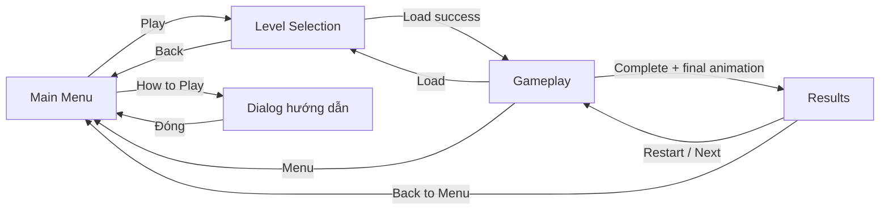

# Stage 2 — UI Design Baseline V1

Ngày: **18/11/2026**. Toàn bộ thiết kế dưới đây **PROPOSED**, chờ Tài/Phước/Hiệp review.
Owner presentation: **Phước**. Đây là specification và wireframe, chưa có GUI/widget/asset/animation implementation.
DTO, enum và ViewPort lấy nguyên tên từ [API Contract](STAGE2_API_CONTRACT.md), không định nghĩa lại ở GUI.

## 1. Screen architecture

`MainWindow` tại `src/gui/app_window.py` là facade duy nhất của Hiệp. Dự kiến dùng QMainWindow + QStackedWidget.
Bốn screen là MainMenu, LevelSelection, GameplayScreen, ResultScreen; How to Play là dialog.
Controller quyết định điều hướng qua ViewPort. Phước quản lý layout, painting, keyboard và visual feedback.
Không đọc JSON puzzle từ widget; LevelSelection nhận tuple LevelSummary, Gameplay nhận public DTO.



Screen hiện tại không tự quyết định game state. Ví dụ LevelSelection có thể xuất hiện trong lúc Engine cũ còn được giữ,
nhưng không cho thao tác trên board cũ và auto đã dừng. Load lỗi không mất committed game.

## 2. Wireframes

### Main Menu

```text
+-----------------------------------------------------------+
|                        GRIDUCTIVE                         |
|                  Giải bí ẩn bằng suy luận                  |
|                                                           |
|                         [ Play ]                          |
|                      [ How to Play ]                      |
|                         [ Exit ]                          |
|                                                           |
|               Không đoán. Chứng minh rồi lật thẻ.           |
+-----------------------------------------------------------+
```

Play phát `play_requested`; How to Play phát `how_to_play_requested`; Exit phát `exit_requested`.
Nội dung hướng dẫn: đọc clue công khai, chọn card, chọn verdict, Hint chỉ gợi ý, Auto chỉ thực hiện bước chứng minh được.
Không thêm tài khoản, leaderboard, lưu tiến độ hoặc settings screen vào V1.

### Level Selection

```text
+----------------------------------------------------------------+
| [Back]                      CHỌN MÀN                            |
|                                                                |
| 3 x 3     [01] [02] [03] [04] [05]                              |
| 4 x 4     [01] [02] [03] [04] [05]                              |
| 5 x 5     [01] [02] [03] [04] [05]                              |
|                                                                |
| Selected: 4x4_03   Size: 4 x 4   Difficulty: Hard*               |
| * Nhãn độ khó từ heuristic thiết kế, chưa hiệu chuẩn người chơi. |
|                                                     [Play]     |
+----------------------------------------------------------------+
```

Chỉ 15 entries do Controller cung cấp theo manifest. Không hiển thị sample, backup, số criminal hoặc deduction trace.
Chọn entry là state local của LevelSelection; Play mới phát `load_requested(puzzle_id)`.
Không có selection thì Play disabled. Nhãn difficulty None hiển thị “Chưa phân loại”.

### Gameplay

```text
+------------------------------------------------------------------------+
| GRIDUCTIVE       4x4_03 / 4 x 4                   Status: READY          |
+-------------------------------------------+----------------------------+
|     A         B         C         D       | CLUES                      |
| 1  [card]    [card]    [card]    [card]     | Public clue list           |
| 2  [card]    [card]    [card]    [card]     | Click clue -> highlight    |
| 3  [card]    [card]    [card]    [card]     +----------------------------+
| 4  [card]    [card]    [card]    [card]     | DEDUCTION TRACE            |
|                                           | Accepted public steps      |
|                                           | Hint shown separately      |
|                                           +----------------------------+
|                                           | PROGRESS: 3 / 16           |
+-------------------------------------------+----------------------------+
| Selected: B2 / Name / Profession            [CRIMINAL] [INNOCENT]       |
+------------------------------------------------------------------------+
| [Load] [Restart] [Hint] [Auto Solve]                          [Menu]      |
+------------------------------------------------------------------------+
```

Name, profession, cell ID là public identity; hidden card không hiển thị verdict hoặc clue.
Clue text dài cuộn trong panel, không làm board đổi kích thước. Trace là accepted history của Controller.
Hint là vùng tạm riêng, không tăng progress. Selected strip không biến Claim thành truth trước ACCEPTED.

### Results

```text
+-----------------------------------------------------------+
|                    PUZZLE COMPLETED                       |
|                        Level 4x4_03                       |
|                                                           |
|       Revealed: 16 / 16      Accepted steps: 13             |
|       Hint requests: 2      Time: <measured or —>           |
|       SAT calls: <measured or —>                           |
|                                                           |
|          [Restart]  [Next Puzzle]  [Back to Menu]           |
+-----------------------------------------------------------+
```

Số liệu chỉ minh họa bố cục, không phải kết quả chạy Stage 2. None hiển thị “—”, không biến thành 0.
Next Puzzle disabled khi next_puzzle_id=None. Không tính score/metrics giả từ kích thước bàn.

## 3. Design system

Phong cách Modern Detective / Mystery Puzzle, dùng typography và đường nét trước; chưa cần bộ tranh nhân vật.
Các token sau là đề xuất để Phước triển khai trong `styles/tokens.py` và QSS dùng cùng giá trị.

| Token | Giá trị | Công dụng |
|---|---|---|
| `background` | `#0B1220` | Nền navy chính |
| `surface` | `#152238` | Panel/card |
| `surface_hover` | `#20324D` | Hover |
| `border` | `#42546E` | Viền thường |
| `text_primary` | `#F1F5F9` | Tên/nội dung |
| `text_secondary` | `#B8C4D8` | Metadata |
| `accent` | `#F2C14E` | Nút chính/selection |
| `criminal` | `#FF7A85` | Badge “CRIMINAL” và biểu tượng |
| `innocent` | `#65D6A4` | Badge “INNOCENT” và biểu tượng |
| `highlight` | `#78BFFF` | Vùng clue tham chiếu |
| `error` | `#FF9B85` | Notification lỗi |
| `disabled_text` | `#8D9BB0` | Control không dùng được |

Không dùng text trắng trên nền accent vàng; nút vàng dùng chữ navy. Kiểm tra contrast thực tế sau render;
mục tiêu chữ thường >=4.5:1, chữ lớn/control boundaries >=3:1. Không tuyên bố palette đã đạt mọi cặp màu khi chưa đo.

| Hạng mục | Quy định V1 |
|---|---|
| Font | System sans hỗ trợ tiếng Việt; fallback Noto Sans, DejaVu Sans; không phụ thuộc tải font mạng |
| Cỡ chữ tại 100% | Title 26 px, heading 18 px, body 14 px, metadata 12 px; nếu card scale làm chữ quá nhỏ thì dùng scroll/zoom |
| Trọng lượng | 600 cho heading/status, 400 cho body |
| Spacing | Thang 4/8/12/16/24/32 logical px; panel padding 16; layout gap 16 |
| Card design size | 144 × 184 logical px, gap 12; corner radius 12 |
| Control | Chiều cao tối thiểu 40; button radius 8; focus ring 2 px |
| Panel | Radius 12; border 1 px; text wrap và scroll dọc |
| Icons | Một bộ line icons local sau này; giai đoạn đầu text + QStyle standard icons; không trộn emoji làm icon chức năng chính |
| Asset policy | Placeholder initials/name là đủ cho baseline; portrait/illustration là scope GUI sau |

QSS áp QWidget; card dùng QGraphicsObject painting đọc cùng tokens. Không hứa QSS tự đổi màu item trong scene.
QGraphicsObject cho phép signals và Qt properties phục vụ animation; không dùng QGraphicsItem thường rồi giả định có QObject properties.

## 4. Card states và input

| Trạng thái | Render | Không được làm |
|---|---|---|
| HIDDEN | Cell ID, tên, nghề, badge “Chưa xác định”, mặt sau thống nhất | Không hiện answer/clue/biểu tượng phân loại dự đoán |
| REVEALED | Cùng identity, badge CRIMINAL hoặc INNOCENT và icon/text tương ứng | Không cho submit verdict lần hai |
| SELECTED overlay | Viền vàng dày 2 px, selected strip cập nhật | Không imply card đã chứng minh |
| HIGHLIGHTED overlay | Viền ngoài xanh/marker vùng | Không che selected ring, không thay status fill |
| Hover | Surface hover + cursor/tooltip public | Không tự select hoặc gọi solver |
| Disabled interaction | Giảm nhấn mạnh control; vẫn đọc được status | Không che mất thông tin public đang cần đọc |
| Animating | Khóa card input; chuyển mặt theo token hiện hành | Không phát click/submit do animation tự gây ra |

Selected và highlighted có thể đồng thời true ở cả hidden/revealed card. Chỉ có một selection;
highlight là tập nhiều cell. Keyboard focus là cờ accessibility riêng, không phải logical status.

Tab đi qua menu/actions và board; mũi tên di chuyển focus trong board theo hàng/cột, Enter/Space chọn card.
Buttons Criminal/Innocent có nhãn chữ, focus rõ và accessible name. Không gán phím tắt nguy hiểm gây submit ngầm.
Không chỉ dùng màu để phân biệt verdict; tooltip/name không chứa hidden clue.

## 5. Animation policy

- Card flip đề xuất **280 ms**, easing InOutCubic; chỉ là giá trị design, chưa có animation thật.
- Phước chọn Qt property/transform của QGraphicsObject để mô phỏng flip 2D; không thêm WebGL/3D engine.
- Chỉ chạy sau `reveal_card(cell_id, PublicCharacterView, AnimationToken)` từ Controller.
- UI chuyển mặt ở giữa animation; clue panel/progress/accepted trace đồng bộ khi Controller nhận completion.
- Phát `animation_finished(cell_id, token)` đúng một lần, token giữ nguyên; không phát lúc cancel.
- `cancel_animations()` cleanup effect và pending handles. Controller resync committed snapshot hoặc đổi screen ngay sau đó.
- Initial reveals trên Load/Restart được render ngay, không xếp hàng animation từng thẻ.
- Reduced motion dùng duration 0; vẫn phát completion queued một lần để giữ barrier, tránh recursion Auto.
- Animation lỗi không cho Auto tiếp tục; Controller watchdog xử lý theo API, không giao widget tự chữa logical state.

## 6. Layout, board scaling và responsive behavior

Viewport mục tiêu desktop 1280×800; kích thước cửa sổ tối thiểu đề xuất 960×640 logical px.
Màn hẹp hơn dùng layout compact/scroll; không ép scale text về kích thước không đọc được.
HiDPI dùng Qt logical coordinates, không tự nhân tọa độ với devicePixelRatio hai lần.

Scene card area, chưa tính margin nhãn trục:

| N | Width = 144N + 12(N−1) | Height = 184N + 12(N−1) |
|---|---:|---:|
| 3 | 456 | 576 |
| 4 | 612 | 772 |
| 5 | 768 | 968 |

Scene có margin ngoài 24 px và chỗ cho nhãn trục. Chỉ scale uniform, không kéo méo card.
Tính fit scale từ viewport thực trừ margins; cap trên 1.0 ở V1.
Minimum scale đề xuất 0.85 để metadata 12 px còn khoảng 10.2 px; nếu fit nhỏ hơn thì giữ 0.85
và cho scroll/pan/zoom. Vì vậy 5×5 có thể cần cuộn; không hứa toàn bộ 25 card vừa màn nhỏ mà chữ vẫn lớn.
Phước có thể đề xuất compact card size sau visual QA nhưng phải cập nhật tokens/spec, không đổi tọa độ logic.

- Width >=1100: board và sidebar cạnh nhau, sidebar khoảng 320–380 px; board nhận không gian còn lại.
- Width 960–1099: sidebar thành tabs Clues/Trace/Progress, giữ tối thiểu 280 px hoặc chuyển xuống dưới nếu board quá hẹp.
- Width <960 hoặc cửa sổ bị ép: sidebar dưới board; root content cuộn; action buttons wrap thành hai hàng.
- Top bar và action bar không được đè board; selected strip wrap tên dài.
- Resize chỉ tính lại layout/transform; không reset selection, rerun SAT hoặc thay PublicBoardSnapshot.
- Trong animation, resize giữ token/card target và không phát completion phụ.

## 7. Component contracts

Owner **tất cả 12 component dưới đây là Phước**. Hiệp tương tác qua MainWindow/ViewPort;
child methods là public nội bộ GUI, không trở thành interface Controller thứ hai.
Tất cả methods trả None nếu không ghi khác. Các DTO/signals lấy kiểu từ API Contract.
Không component nào phụ thuộc SAT, LogicAgent implementation hoặc file puzzle.

| Component / file dự kiến | Chức năng, input → output | Public methods / signals | State, dependencies, quy tắc |
|---|---|---|---|
| `MainWindow` / `app_window.py` | Root nhận public DTO → render screen, forward UI intent | Toàn bộ ViewPort và GUI→Controller signals trong API | Screen, render session; Qt Widgets + screens; không giữ Engine; forwarding đúng một lần |
| `MainMenu` / `screens/main_menu.py` | Menu, không cần puzzle → Play/Help/Exit intent | `set_enabled(enabled: bool)`; `play_requested()`, `how_to_play_requested()`, `exit_requested()` | Enabled/focus; QWidget; không tự tạo gameplay |
| `LevelSelection` / `screens/level_selection.py` | `tuple[LevelSummary, ...]` → chọn ID/load intent | `set_levels(levels: tuple[LevelSummary, ...])`, `set_enabled(enabled: bool)`; `load_requested(puzzle_id: str)`, `back_requested()` | Local selected puzzle ID; QWidget; không đọc manifest/raw JSON |
| `GameplayScreen` / `screens/gameplay.py` | Snapshot + updates → board/sidebar/strip | `set_board(snapshot: PublicBoardSnapshot)`, `set_selection(cell_id: str \| None)`, `set_busy(state: GameState)`; forward card/clue/verdict/actions/animation events | Public render state; GameBoard, panels, ActionBar; không tự state transition |
| `ResultScreen` / `screens/results.py` | ResultsView → statistics/navigation | `set_results(results: ResultsView)`; `restart_requested()`, `load_requested(puzzle_id: str)`, `back_requested()` | Next enabled iff next ID có; QWidget; không tính statistics từ key |
| `GameBoard` / `grid_view.py` | Tuple card views + N → scene card grid | `set_board(snapshot: PublicBoardSnapshot)`, `set_selection(cell_id: str \| None)`, `highlight_cells(cell_ids: tuple[str, ...])`, `clear_highlights()`, `reveal_card(cell_id: str, public_data: PublicCharacterView, token: AnimationToken)`, `cancel_animations()`; `card_selected(cell_id: str)`, `animation_finished(cell_id: str, token: AnimationToken)` | Scene, ID→card render map; QGraphicsView/Scene, CharacterCard; tọa độ lấy metadata |
| `CharacterCard` / `components/character_card.py` | PublicCharacterView → card, click | `set_public_data(data: PublicCharacterView)`, `set_selected(selected: bool)`, `set_highlighted(highlighted: bool)`, `set_interactive(enabled: bool)`; `card_selected(cell_id: str)` | Visibility, selected, highlighted, hover/focus; QGraphicsObject; không tự bật revealed khi click |
| `CluePanel` / `components/clue_panel.py` | PublicClueView tuple → danh sách text | `set_clues(clues: tuple[PublicClueView, ...])`; `clue_selected(clue_id: str)` | Selected clue/scroll position; QWidget; chỉ emit ID, không resolve region |
| `DeductionPanel` / `components/deduction_panel.py` | Accepted step / hint → lịch sử và hint tách biệt | `append_deduction_step(step: DeductionStepView)`, `show_hint(hint: HintView)`, `clear()`; không có domain signal | Step keys chống duplicate, hint hiện tại; QWidget; không tự tạo explanation |
| `ActionBar` / `components/action_bar.py` | GameState + selected public card → buttons | `set_busy(state: GameState)`, `set_selection(character: PublicCharacterView \| None)`; `verdict_requested(cell_id: str, verdict: Claim)`, `level_selection_requested()`, `restart_requested()`, `hint_requested()`, `auto_solve_requested()`, `back_requested()` | State, selection; QWidget; UNKNOWN không phải nút verdict |
| `CardFlipAnimation` / `animations/card_flip.py` | Card + dữ liệu đã accepted + token → effect/completion | `start(card: CharacterCard, public_data: PublicCharacterView, token: AnimationToken)`, `cancel()`; `animation_finished(cell_id: str, token: AnimationToken)` | Idle/running/cancelled; Qt Animation Framework; một completion, không commit Engine |
| `NotificationDialog` / `components/notification_dialog.py` | ActionResult hoặc help text → safe message | `show_notification(result: ActionResult)`, `show_how_to_play()`; không domain signal | Hidden/visible; QDialog/QMessageBox; plain text, không hiển thị traceback/private content |

`clue_highlighter.py` chỉ là visual helper của GameBoard, không có Controller API riêng.
MainWindow chịu trách nhiệm điều phối child calls cho ViewPort đầy đủ, kể cả clear hint sau `set_board` mới.
Không cần tạo tất cả class/file này trong baseline; bảng là kế hoạch cho nhánh GUI sau khi review.

## 8. Action enablement

| GameState | Verdict / Hint / Auto | Card/Clue selection | Load / Restart / Menu |
|---|---|---|---|
| NO_PUZZLE | Disabled | Không board | Load qua LevelSelection; Restart disabled |
| READY | Enabled; verdict cần selected hidden card | Enabled | Enabled |
| PROCESSING | Disabled | Disabled | Enabled, xử lý cancel qua Controller |
| ANIMATING | Disabled | Disabled | Enabled, xử lý cancel/resync |
| STUCK | Enabled để nhận thông báo/recheck; không tự đoán | Enabled | Enabled |
| SOLVED | Disabled | Có thể xem public clues nếu còn Gameplay | Restart/Next/Menu từ Results |
| ERROR | Disabled | Không thao tác game | Load/Restart nếu có game/Menu |

Enabled không thay validation ở Controller: event queued cũ vẫn có thể tới sau khi button bị disabled.
Status bar hiển thị PROCESSING/ANIMATING/STUCK rõ ràng; không hiển thị “đã giải” khi chỉ mới tìm được một SAT model.

## 9. Design acceptance criteria cho nhánh GUI sau này

- [ ] Bốn screen đúng wireframe, đủ 15 LevelSummary, không đọc raw puzzle.
- [ ] Render public mock cho 3×3, 4×4, 5×5; initial/hidden/revealed/selected/highlighted và simultaneous overlays.
- [ ] Không có field/tooltip/accessibility label tiết lộ clue hidden hoặc verdict chưa accepted.
- [ ] Tên nghề dài và tiếng Việt không tràn card/panel; scroll/scale hoạt động ở kích thước tối thiểu và HiDPI.
- [ ] Contrast được đo trên cặp màu thực tế; keyboard focus và label không dựa riêng vào màu.
- [ ] Hiệp có thể điều khiển tất cả bằng ViewPort, không chạm child widget.
- [ ] pytest-qt xác nhận một click → một event; programmatic update không phát request vòng lặp.
- [ ] Completion đúng một lần; cancel không completion; reduced motion và resize không phá token.
- [ ] Qt desktop smoke test và offscreen tests chạy với phiên bản đã pin sau review.
- [ ] Chưa đánh dấu GUI hoàn thành chỉ vì mock render đúng; full integration dùng Core/Encoder/DPLL thật là bước riêng.
